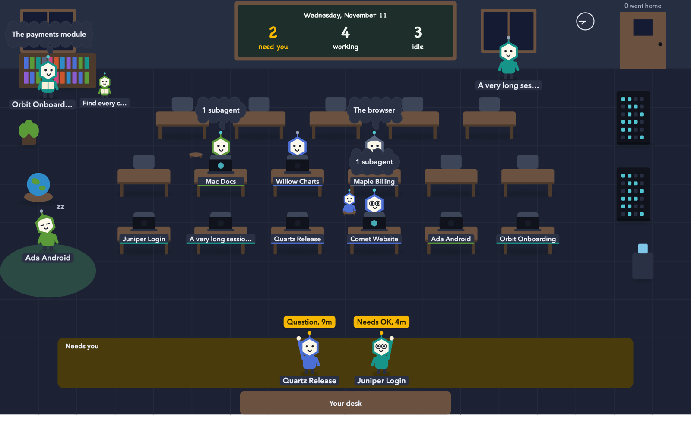

# Agent Hive

A Mac app that shows every AI coding agent session on your Mac in one place: which ones need you, what each
one is doing right now, their subagents, and what they've been saying. It works with Claude Code, and also
shows Google Antigravity conversations and OpenClaw automations when you have them.



*The Classroom view, shown with sample data. Each character is a session: hands up at the front means it's
waiting on you; the shelf, globe and machine mean reading files, browsing and running a command; small
characters are subagents.*

Agent Hive reads local files only. It never reads your logins, tokens or Keychain, and sends nothing over the
network. See [What it reads](#what-it-reads).

> **Status:** early (0.1). It's used daily by its author, but expect rough edges.

## What you get

| View | What it shows |
|---|---|
| **Agents** | Every live session, grouped into *Needs you*, *Working* and *Idle*, with a plain-language headline. Open a session to see its plan, your last request, its latest report, a timeline, subagents, pull requests and running commands. |
| **Classroom** | The same sessions as characters in a room, positioned by what they're really doing. Click one for its details. An editor lets you arrange desks, furniture and decorations on a tile grid. |
| **Terminal** | A read-only, live feed of a session: commands and their output, file edits, tool calls, messages, and thinking where Claude Code saved its text. |
| **Activity** | What all your agents have said recently, newest first. |
| **Usage** | Tokens written per day, project, model and session, for the last 7 days. |
| **Skills** | Every installed skill and plugin with its version, with **Check for updates** and **Update** for Claude Code plugins. |
| **System** | Other agent apps that are running, OpenClaw tasks and schedules, and what is keeping your Mac busy. |

A menu bar icon shows how many sessions need you. **Open in Claude** jumps straight to a session in the Claude
app.

### When a session "needs you"

- It's waiting on a permission prompt, a question, or a plan to approve.
- Or its turn ended with questions written in its message, such as a "Left for you to decide" list or a closing
  "Should I push it?". These clear as soon as you send that session a new message.

## Install

Requires macOS 15 or later on an Apple silicon Mac.

1. Download `Agent-Hive-<version>-arm64.zip` from [Releases](../../releases) and unzip it.
2. Move **Agent Hive.app** to your Applications folder.
3. Open it. The app isn't signed with an Apple Developer ID yet, so macOS blocks it the first time. Go to
   **System Settings > Privacy & Security**, scroll down, and click **Open Anyway** next to Agent Hive.
   Or, in Terminal:

   ```bash
   xattr -dr com.apple.quarantine "/Applications/Agent Hive.app"
   ```

To start it when you log in, turn on **Start Agent Hive at login** in its Settings (from the menu bar icon).

You need [Claude Code](https://claude.com/claude-code) for anything to show up. Sessions from the Claude
desktop app and from the `claude` command line both appear.

## Build from source

Requires Xcode 16 or later (Swift 6).

```bash
git clone https://github.com/zeusqolivar/agent-hive.git
cd agent-hive
swift test                      # run the tests
scripts/bundle.sh release       # builds build/Agent Hive.app (ad-hoc signed)
open "build/Agent Hive.app"
```

`swift run HiveApp` also works while developing.

## What it reads

| Data | From |
|---|---|
| Live sessions, names, status | `~/.claude/sessions/<pid>.json`. The `.key` files beside them are never opened. |
| Timeline, plan, report, questions, model, branch | The end of `~/.claude/projects/<folder>/<session>.jsonl` |
| Subagents | `<session>/subagents/` next to each transcript |
| Commands, memory, CPU | `ps` |
| Background command output | `/private/tmp/claude-<uid>/*/<session>/tasks/*.output` |
| Google Antigravity | `~/.gemini/antigravity/conversation_summaries.db` (read-only), its transcripts and `daemon/hub_*.json` |
| Tokens | Transcripts changed in the last 8 days |
| Skills | `~/.claude/plugins`, `~/.claude/skills`, `~/.agents/skills`, `~/.cursor/skills`, OpenClaw's and Antigravity's skill folders |
| OpenClaw | `~/.openclaw/state/openclaw.sqlite` (read-only) |
| Your classroom layout | `~/Library/Application Support/Agent Hive/classroom.json`, the only file it writes |

The only commands it runs are `ps`; the skills commands you start from the Skills view (`claude plugin
marketplace update`, `claude plugin update <id>`, `openclaw skills update --all`); `claude --resume` when you
send a reply; and `open` and `osascript` to bring Antigravity forward when you click **Open in Antigravity**.

## Replying from the app

You can reply to a session that **isn't running**. The app runs `claude --resume <id> -p` in the session's
folder, with your text on stdin and your own permission settings; it never adds flags that skip permissions.

A session that is running, in the Claude app or a terminal, has no reply box: two writers split its
conversation into separate branches. Permission prompts can't be answered from outside Claude either, so those
sessions show **Open in Claude** instead. Replies use the `claude` command line's own sign-in, which can differ
from the Claude app's. Details: [docs/spikes/S1-reply.md](docs/spikes/S1-reply.md).

## Known limitations

- **Remaining plan usage isn't shown.** Claude Code passes it only to status line commands in terminal
  sessions; desktop-app sessions don't run them. Details:
  [docs/spikes/S2-statusline.md](docs/spikes/S2-statusline.md).
- **Thinking:** Claude Code stores most thinking blocks without their text, so the Terminal view shows those as
  "not saved".
- **Apple silicon only** for now, and unsigned (see [Install](#install)).
- The views are web pages inside the app's window, so the Classroom only animates while the window is visible.

## Development

| Path | What |
|---|---|
| `Sources/HiveCore` | Reads sessions, transcripts, subagents, processes, usage, skills, Antigravity and OpenClaw, and builds the JSON the pages read |
| `Sources/HiveApp` | The window, menu bar icon, settings, the `hive://` scheme handler, and native actions |
| `Sources/HiveApp/Resources/web` | The pages (plain HTML, CSS and JavaScript) |
| `Tests/HiveCoreTests` | Unit and contract tests. `Fixtures/home` is a made-up home folder, and `Fixtures/expected` holds the expected JSON for it |
| `docs/spikes` | Investigations into replying to sessions and reading plan usage |

There's no server and no open port: the pages ask `hive://app/api/...`, and the app answers in Swift.

Developer options:

| Option | Does |
|---|---|
| `HiveApp --dump /api/board /api/usage ...` | Prints the app's answer for each path after one refresh, then exits |
| `HiveApp --open "#/classroom"` | Opens the window on a view |
| `HiveApp --login-item on\|off\|status` | Registers or removes the login item (bundled app only) |
| `HIVE_DEBUG_TIMING=1` | Prints how long each refresh takes |

Issues and pull requests are welcome. Please keep fixtures free of real paths, names and transcripts.

## License

MIT. See [LICENSE](LICENSE).

Agent Hive is an independent project. It isn't affiliated with or endorsed by Anthropic or Google. Claude and
Claude Code are trademarks of Anthropic; Antigravity and Gemini are trademarks of Google.
