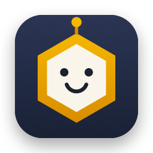
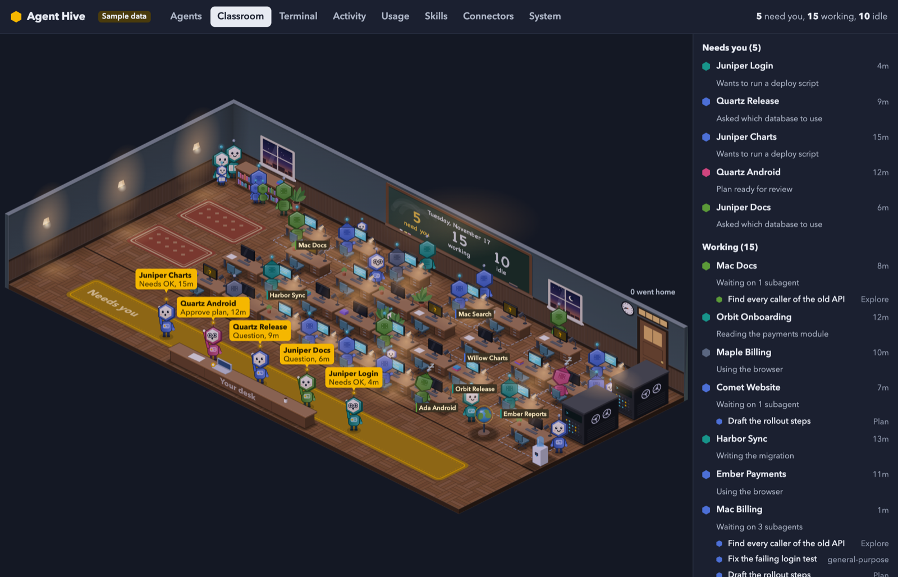
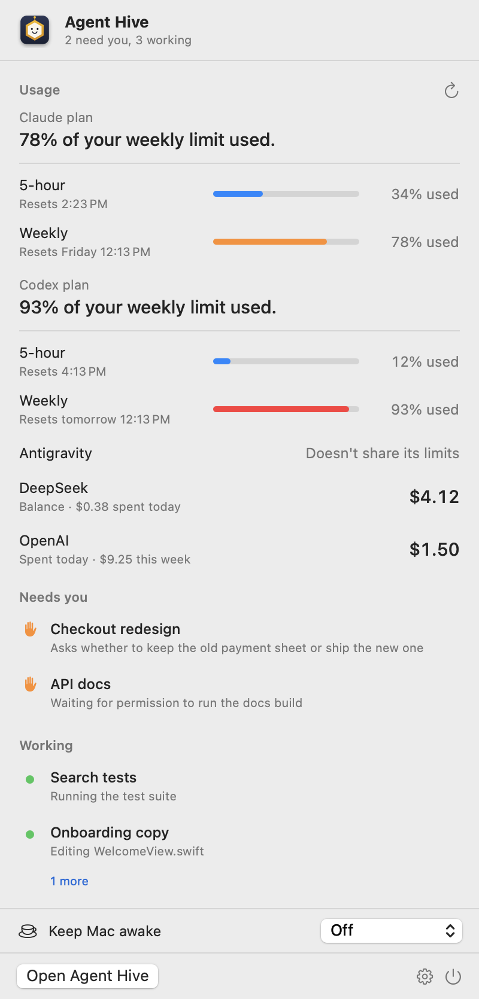

# Agent Hive

A Mac app that shows every AI coding agent session on your Mac in one place: which ones need you, what each
one is doing right now, their subagents, and what they've been saying. It works with Claude Code, and also
shows Google Antigravity conversations and OpenClaw automations when you have them.



*The Classroom view, shown with sample data. Each character is a session: hands up at the front means it's
waiting on you; the shelf, globe and machine mean reading files, browsing and running a command; small
characters are subagents.*

Agent Hive reads local files. It never reads other tools' logins or tokens, and sends nothing over the network
unless you add an API key for a usage service, which it sends only to that service. See
[What it reads](#what-it-reads).

> **Status:** early (0.3). It's used daily by its author, but expect rough edges.

## What you get

| View | What it shows |
|---|---|
| **Agents** | Every live session, grouped into *Needs you*, *Working* and *Idle*, with a plain-language headline. Open a session to see its plan, your last request, its latest report, a timeline, subagents, pull requests and running commands. |
| **Classroom** | The same sessions as characters in a room, positioned by what they're really doing. Click one for its details. An editor lets you arrange desks, furniture and decorations on a tile grid. |
| **Terminal** | A read-only, live feed of a session: commands and their output, file edits, tool calls, messages, and thinking where Claude Code saved its text. |
| **Activity** | What all your agents have said recently, newest first. |
| **Usage** | **Limits and spending**: your Claude plan's 5-hour and weekly windows (with the opt-in status line below), Codex's plan windows, and the balance and spending of the API keys you add. Then tokens written per day, project, model and session, for the last 7 days. |
| **Skills** | Every installed skill and plugin with its version, with **Check for updates** and **Update** for Claude Code plugins. |
| **Connectors** | Each agent's MCP connectors (Claude Code, the Claude app, Antigravity, Codex, Cursor, OpenClaw): name, local or web, where it's set up, and the server's host name. Commands, settings, addresses and keys aren't shown. |
| **System** | Other agent apps that are running, OpenClaw tasks and schedules, and what is keeping your Mac busy. |

A menu bar icon shows how many sessions need you and the percentage of your most-pressed plan window, so the limit
is visible without opening anything. Click it for a panel with your plan limits as bars, API-key balances and
spending, the sessions that need you and those working, and **Keep Mac awake**; click a session to open it.
**Open in Claude** jumps straight to a session in the Claude app.



**Keep Mac awake**, in the menu bar panel and Settings, stops your Mac from going to sleep on its own so agents
keep running: *While agents are working* (lets it sleep once every session is idle), *Always*, or *For 1 hour*. A
coffee cup appears on the menu bar icon while it's on. The screen can still turn off, and closing the lid on
battery still sleeps.

### Limits and spending

- **Claude plan:** Claude Code shares your plan's limits only with a status line command. **Set up** (in the
  Usage view or in Settings > Usage services) adds a small script, `~/Library/Application Support/Agent
  Hive/statusline.sh`, as the `statusLine` in `~/.claude/settings.json`. It saves the `rate_limits` part of what
  Claude Code passes it and then runs the status line you already had, so yours keeps working. The figures
  update only while you use Claude Code in a terminal; the Claude app doesn't run status lines. **Remove** puts
  your previous status line back exactly.
- **Codex plan:** read from the newest session log in `~/.codex/sessions`.
- **Antigravity** doesn't record its limits on your Mac, so its card says so.
- **API keys:** add a key in Settings > Usage services for DeepSeek or OpenRouter (balance and spending) or an
  Admin key for OpenAI or Anthropic (daily costs). Keys are stored in your Keychain (service
  `io.github.agenthive.AgentHive.usage`), sent only to their own service every 15 minutes and when you click
  **Refresh**, and never shown again or written to any file. DeepSeek reports a balance but no history, so its
  spending is estimated from balance changes while Agent Hive runs; top-ups aren't counted. A refused key stops
  automatic checks until you change it or click Refresh. Because the app is ad-hoc signed, macOS may ask once
  after an update whether Agent Hive may use its key; choose **Always Allow**.

### When a session "needs you"

- It's waiting on a permission prompt, a question, or a plan to approve.
- Or its turn ended with questions written in its message, such as a "Left for you to decide" list or a closing
  "Should I push it?". These clear as soon as you send that session a new message.

## Install

Requires macOS 15 or later on an Apple silicon Mac.

1. Download `Agent-Hive-<version>-arm64.zip` from [Releases](../../releases) and unzip it.
2. Move **Agent Hive.app** to your Applications folder.
3. Open it. The app isn't signed with an Apple Developer ID yet, so macOS blocks it the first time. Go to
   **System Settings > Privacy & Security**, scroll down, and click **Open Anyway** next to Agent Hive.
   Or, in Terminal:

   ```bash
   xattr -dr com.apple.quarantine "/Applications/Agent Hive.app"
   ```

To start it when you log in, turn on **Start Agent Hive at login** in its Settings (from the menu bar icon).

You need [Claude Code](https://claude.com/claude-code) for anything to show up. Sessions from the Claude
desktop app and from the `claude` command line both appear.

## Build from source

Requires Xcode 16 or later (Swift 6).

```bash
git clone https://github.com/zeusqolivar/agent-hive.git
cd agent-hive
swift test                      # run the tests
scripts/bundle.sh release       # builds build/Agent Hive.app (ad-hoc signed)
open "build/Agent Hive.app"
```

`swift run HiveApp` also works while developing.

## What it reads

| Data | From |
|---|---|
| Live sessions, names, status | `~/.claude/sessions/<pid>.json`. The `.key` files beside them are never opened. |
| Timeline, plan, report, questions, model, branch | The end of `~/.claude/projects/<folder>/<session>.jsonl` |
| Subagents | `<session>/subagents/` next to each transcript |
| Commands, memory, CPU | `ps` |
| Background command output | `/private/tmp/claude-<uid>/*/<session>/tasks/*.output` |
| Google Antigravity | `~/.gemini/antigravity/conversation_summaries.db` (read-only), its transcripts and `daemon/hub_*.json` |
| Tokens | Transcripts changed in the last 8 days |
| Skills | `~/.claude/plugins`, `~/.claude/skills`, `~/.agents/skills`, `~/.cursor/skills`, OpenClaw's and Antigravity's skill folders |
| OpenClaw | `~/.openclaw/state/openclaw.sqlite` (read-only) |
| Connectors | `~/.claude.json` (`mcpServers` and each project's), `.mcp.json` in installed and synced plugins under `~/.claude/plugins`, `~/Library/Application Support/Claude/claude_desktop_config.json`, `~/.gemini/antigravity/mcp_config.json`, `~/.gemini/antigravity-ide/mcp_config.json`, `~/.gemini/config/mcp_config.json`, `~/.codex/config.toml`, `~/.cursor/mcp.json`, `~/.openclaw/*.json`. Only names, types, scopes and host names leave the reader. |
| Codex plan limits | The latest `rate_limits` in the newest `~/.codex/sessions/**/rollout-*.jsonl` |
| Its own files | `~/Library/Application Support/Agent Hive/`: `classroom.json` (your classroom layout), and only if you use them, `statusline.sh`, `statusline-previous.json` and `claude-limits.json` (the Claude status line) and `usage-history.json` (balances and times for the spending estimate) |
| Claude settings | `~/.claude/settings.json`, changed only when you click **Set up** or **Remove** for the Claude status line, and only its `statusLine` |
| API keys | Your Keychain, only the items Agent Hive saved |

**Network:** none, unless you add a key. Then only the service you added it for: `api.deepseek.com`,
`openrouter.ai`, `api.openai.com` or `api.anthropic.com`.

The only commands it runs are `ps`; the skills commands you start from the Skills view (`claude plugin
marketplace update`, `claude plugin update <id>`, `openclaw skills update --all`); `claude --resume` when you
send a reply; and `open` and `osascript` to bring Antigravity forward when you click **Open in Antigravity**.

## Replying from the app

You can reply to a session that **isn't running**. The app runs `claude --resume <id> -p` in the session's
folder, with your text on stdin and your own permission settings; it never adds flags that skip permissions.

A session that is running, in the Claude app or a terminal, can't take a reply from outside: two writers split
its conversation into separate branches. For those, type your answer in the session's details and click **Copy
& open in Claude**: your answer is copied and the session opens in Claude, ready to paste. Permission prompts
can't be answered from outside Claude either. Replies use the `claude` command line's own sign-in, which can differ
from the Claude app's. Details: [docs/spikes/S1-reply.md](docs/spikes/S1-reply.md).

## Known limitations

- **Claude plan limits update only from terminal sessions.** Claude Code passes them only to status line
  commands, which the Claude app doesn't run, and a project with its own `statusLine` replaces the user-level
  one. Details: [docs/spikes/S2-statusline.md](docs/spikes/S2-statusline.md).
- **Connectors added in claude.ai's settings** live on Anthropic's servers and aren't listed.
- **Thinking:** Claude Code stores most thinking blocks without their text, so the Terminal view shows those as
  "not saved".
- **Apple silicon only** for now, and unsigned (see [Install](#install)).
- The views are web pages inside the app's window, so the Classroom only animates while the window is visible.

## Development

| Path | What |
|---|---|
| `Sources/HiveCore` | Reads sessions, transcripts, subagents, processes, usage, skills, connectors, plan limits, Antigravity and OpenClaw, and builds the JSON the pages read. `Limits/` holds the Keychain key store, the usage-service providers and the status line installer |
| `Sources/HiveApp` | The window, menu bar icon, settings, the `hive://` scheme handler, and native actions |
| `Sources/HiveApp/Resources/web` | The pages (plain HTML, CSS and JavaScript), maintained here |
| `Tests/HiveCoreTests` | Unit and contract tests. `Fixtures/home` is a made-up home folder, and `Fixtures/expected` holds the expected JSON for it; `Fixtures/connectors-home` and `Fixtures/limits` hold made-up connector configs, provider responses and Codex logs. No test reaches the network or your real settings |
| `scripts/make_icon.swift` | Draws the app icon and writes `Sources/HiveApp/Resources/AppIcon.icns` and `docs/icon.png` (run from the repository root) |
| `docs/spikes` | Investigations into replying to sessions and reading plan usage |

There's no server and no open port: the pages ask `hive://app/api/...`, and the app answers in Swift.

Developer options:

| Option | Does |
|---|---|
| `HiveApp --dump /api/board /api/usage ...` | Prints the app's answer for each path after one refresh, then exits |
| `HiveApp --open "#/classroom"` | Opens the window on a view |
| `HiveApp --panel-snapshot <file.png> [--sample] [--dark]` | Draws the menu bar panel into a PNG, with your data or made-up data |
| `HiveApp --login-item on\|off\|status` | Registers or removes the login item (bundled app only) |
| `HIVE_DEBUG_TIMING=1` | Prints how long each refresh takes |

Issues and pull requests are welcome. Please keep fixtures free of real paths, names and transcripts.

## License

MIT. See [LICENSE](LICENSE).

Agent Hive is an independent project. It isn't affiliated with or endorsed by Anthropic or Google. Claude and
Claude Code are trademarks of Anthropic; Antigravity and Gemini are trademarks of Google.
